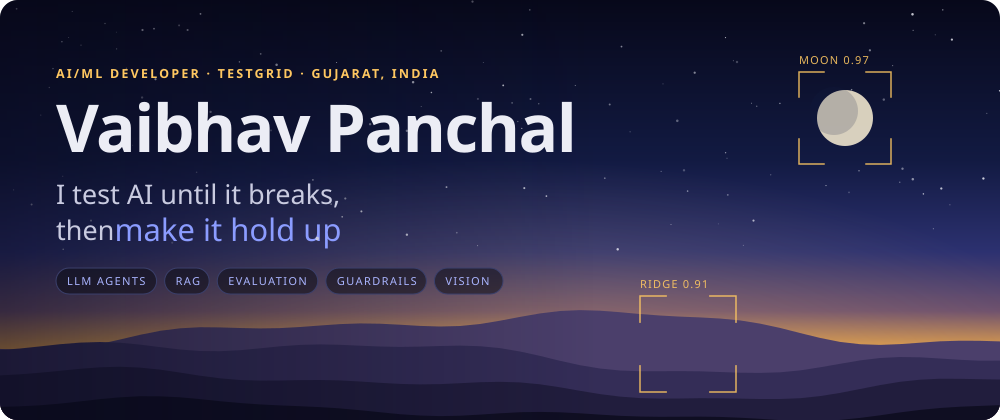
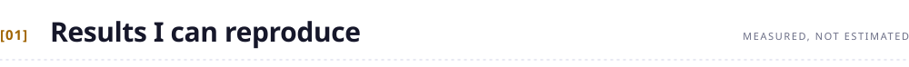
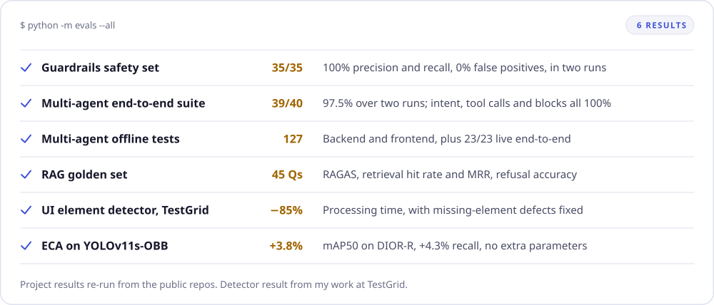
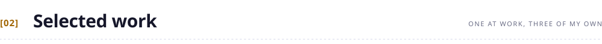
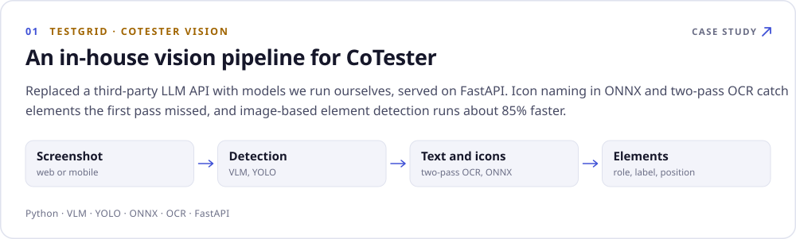
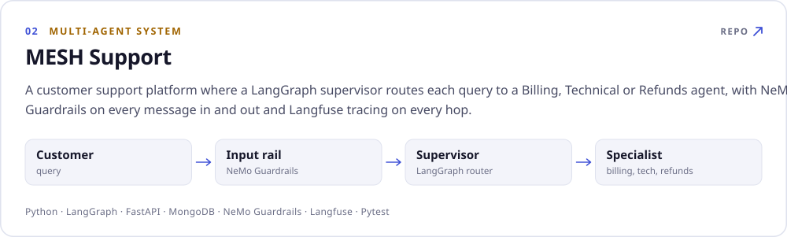
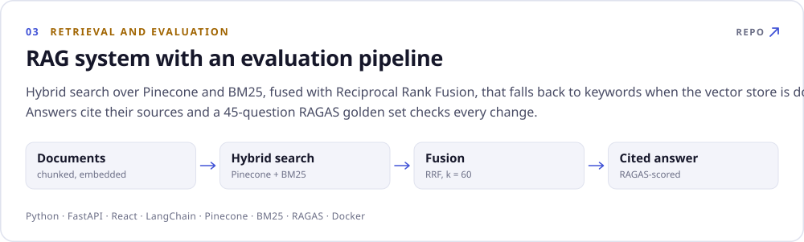
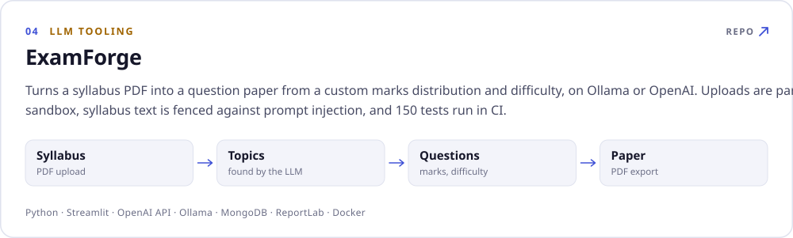
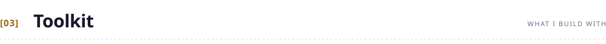
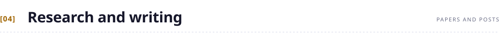

<a href="https://portfolio-4gke.vercel.app"><picture><source media="(prefers-color-scheme: dark)" srcset="assets/link-portfolio-dark.svg" /></picture></a>
<a href="https://portfolio-4gke.vercel.app/Vaibhav_Panchal_Resume.pdf"><picture><source media="(prefers-color-scheme: dark)" srcset="assets/link-resume-dark.svg" /></picture></a>
<a href="https://www.linkedin.com/in/vaibhav-panchal-7a2381221/"><picture><source media="(prefers-color-scheme: dark)" srcset="assets/link-linkedin-dark.svg" /></picture></a>
<a href="https://medium.com/@vaibhavpanchal1808"><picture><source media="(prefers-color-scheme: dark)" srcset="assets/link-medium-dark.svg" /></picture></a>
<a href="mailto:vaibhavpanchal1808@gmail.com"><picture><source media="(prefers-color-scheme: dark)" srcset="assets/link-email-dark.svg" /></picture></a>

I work on **CoTester**, TestGrid's AI testing agent: the vision models that read a screen, and the testing that decides whether a new agent is ready to ship. Outside work I build LangGraph agents and RAG systems, and I measure them before I claim anything about them.

 

<picture><source media="(prefers-color-scheme: dark)" srcset="assets/head-results-dark.svg" /></picture>

<picture><source media="(prefers-color-scheme: dark)" srcset="assets/results-dark.svg" /></picture>

 

<picture><source media="(prefers-color-scheme: dark)" srcset="assets/head-work-dark.svg" /></picture>

<a href="https://portfolio-4gke.vercel.app/work/ui-element-vision"><picture><source media="(prefers-color-scheme: dark)" srcset="assets/work-cotester-dark.svg" /></picture></a>

<a href="https://github.com/vaibhav-panchal8277/Multi-Agent-Customer-Support-System"><picture><source media="(prefers-color-scheme: dark)" srcset="assets/work-mesh-dark.svg" /></picture></a>
<a href="https://multi-agent-customer-support-system-ten.vercel.app"><picture><source media="(prefers-color-scheme: dark)" srcset="assets/link-demo-dark.svg" /></picture></a>

<a href="https://github.com/vaibhav-panchal8277/Production-RAG-System-with-Evaluation"><picture><source media="(prefers-color-scheme: dark)" srcset="assets/work-rag-dark.svg" /></picture></a>
<a href="https://production-rag-system-with-evaluati-nine.vercel.app"><picture><source media="(prefers-color-scheme: dark)" srcset="assets/link-demo-dark.svg" /></picture></a>

<a href="https://github.com/vaibhav-panchal8277/examforge"><picture><source media="(prefers-color-scheme: dark)" srcset="assets/work-examforge-dark.svg" /></picture></a>

 

<picture><source media="(prefers-color-scheme: dark)" srcset="assets/head-toolkit-dark.svg" /></picture>

<picture><source media="(prefers-color-scheme: dark)" srcset="assets/toolkit-dark.svg" /></picture>

 

<picture><source media="(prefers-color-scheme: dark)" srcset="assets/head-research-dark.svg" /></picture>

**Channel attention for oriented object detection in remote sensing** · *under review, 2025* 
Added Efficient Channel Attention to YOLOv11s-OBB for small, densely packed objects in aerial images: **+3.8% mAP50** and **+4.3% recall** on DIOR-R, with no increase in parameters.

**Hybrid deep learning for network intrusion detection** · *manuscript in preparation* · [code](https://github.com/vaibhav-panchal8277/IDS-SYSTEM) 
A CNN-BiLSTM-Attention model over network-flow data: **98.4%+ accuracy** on NSL-KDD and CICIDS, ahead of Random Forest and SVM on every attack category.

**[Agentic AI in Production: When AI Stops Answering and Starts Doing](https://medium.com/@vaibhavpanchal1808/agentic-ai-in-production-when-ai-stops-answering-and-starts-doing-012c39ae9b90)** · *Medium* 
What changes when a model stops answering questions and starts taking actions.

 

M.E. Software Engineering, L.D. College of Engineering · B.E. Computer Engineering, GDEC Navsari · Images in this README are generated by <a href="scripts/build.py"><code>scripts/build.py</code></a>.
